<!-- ═══════════════════════ HERO ═══════════════════════ -->

  

  
  
  
  

<!-- ═══════════════════════ ABOUT ═══════════════════════ -->
<h3 align="center">⚡ ABOUT ME</h3>

  

<!-- ═══════════════════════ STACK ═══════════════════════ -->
<h3 align="center">🛠️ TECH STACK</h3>

<table align="center">
  <tr>
    <td align="center" width="140"><b>Languages</b></td>
    <td></td>
  </tr>
  <tr>
    <td align="center"><b>Frameworks</b></td>
    <td></td>
  </tr>
  <tr>
    <td align="center"><b>Data & Tools</b></td>
    <td></td>
  </tr>
</table>

<!-- ═══════════════════════ STATS ═══════════════════════ -->
<h3 align="center">📊 GITHUB ANALYTICS</h3>

  
  

  

  

<!-- ═══════════════════════ SNAKE ═══════════════════════ -->
<h3 align="center">🐍 CONTRIBUTIONS</h3>

  

<!-- ═══════════════════════ FOOTER ═══════════════════════ -->

  

  ⭐ Star a repo if you like my work · Feedback? Open an issue or reach out on <a href="https://www.linkedin.com/in/sandaru-wagachchi-8996a32b2/">LinkedIn</a>

